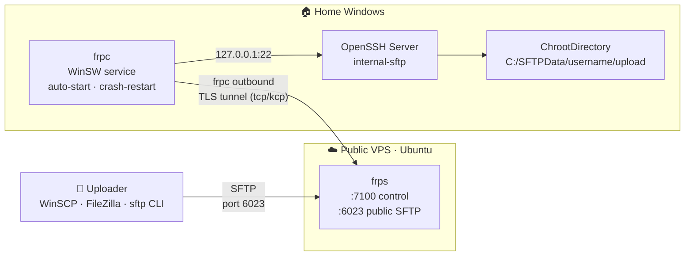

<div align="center">

# 🏠 home-sftp-frp

**Home SFTP Public Upload Gateway**

Let people outside your network securely upload files to your home Windows PC —
no public IP, no router port forwarding, no exposure of your home network.

[简体中文](README.md) · **English**

[](#-architecture)
[](https://github.com/fatedier/frp)
[](LICENSE)

[✨ Features](#-features) · [🏗 Architecture](#-architecture) · [🚀 Quick Start](#-quick-start) · [🔐 Security](#-security-design) · [❓ Troubleshooting](#-troubleshooting)

</div>

---

## 📖 What is this

Colleagues, friends, or automation devices outside your network need to send you files?

This project provides a **set of one-shot, idempotent installer scripts** that turn a home
Windows PC into an SFTP server and expose it through a cheap public VPS running
[frp](https://github.com/fatedier/frp) reverse proxy. Each uploader gets their own account,
lands directly in their own `/upload` directory and is chrooted there — they can see neither
each other's files nor anything else on your system.

> Built on battle-tested open-source components: [frp](https://github.com/fatedier/frp) (reverse
> proxy) · Windows built-in OpenSSH Server · [WinSW](https://github.com/winsw/winsw) (Windows
> service wrapper) · [WinSCP](https://winscp.net) (GUI client)

## ✨ Features

- 🔒 **Strict chroot isolation** — one `ChrootDirectory` per account + NTFS ACL with inheritance
  removed; accounts cannot see each other
- 🙈 **Zero home network exposure** — frpc only makes outbound connections; no inbound ports at
  home; uploaders only ever see the VPS IP
- 🔐 **Multi-layer encryption & auth** — frp forces TLS + random token; SFTP uses standard SSH
- 🩹 **Self-healing** — frp heartbeat reconnect, in-process relogin (`loginFailExit = false`),
  Windows service auto-restart on crash, auto start on boot
- ⚡ **One-shot deployment on both ends** — one Bash script for the VPS, one PowerShell script
  for the home Windows box, all idempotent
- 🚄 **Optional KCP tunnel** — one `.env` switch (`FRP_TRANSPORT=kcp`) for lossy home broadband
  links (UDP transport)
- 👥 **Full account lifecycle** — list / add / remove in one command each; optional NTFS hard
  quota (`SFTP_USER_QUOTA_GB`) and retention cleanup task (`SFTP_RETENTION_DAYS`)
- 🔔 **Optional upload notification** — POST a webhook (Server酱-ready) when new files arrive
- 🛡 **Defense in depth** — fail2ban, `ufw limit` rate limiting, loopback-only admin dashboard,
  upload accounts denied shell/port-forwarding/TTY **and interactive/RDP logon** (secedit),
  frps `allowPorts` whitelist so a leaked token cannot turn the VPS into a jump host,
  pinned official sha256 for every downloaded binary, unattended security upgrades
- 🧪 **Self-check & uninstall** — one command each on both ends, including a
  credential-free full-chain probe; idempotent uninstallers
- 🇨🇳 **China-network friendly** — GitHub download failures automatically fall back to CN mirror
  proxies (checksum-verified), tuned for Tencent Cloud Lighthouse

## 🏗 Architecture



**Data flow:**

1. The uploader connects to `VPS_IP:6022` with any SFTP client (only the VPS IP is visible);
2. frps forwards traffic through the **TLS tunnel** to the home frpc that dialed out;
3. frpc hands it to the local sshd `internal-sftp` (home port 22 is firewalled to LAN only);
4. sshd chroots each `Match User` block to `C:\SFTPData\<username>`, landing in `/upload`.

## 📦 Project layout

```
home-sftp-frp/
├── README.md / README.en.md         ← docs (CN / EN)
├── CHANGELOG.md                     ← changelog, newest first
├── SECURITY.md / CONTRIBUTING.md
├── .env.example                     ← single source of config (copy to .env)
├── config/                          ← reference templates; kept in sync with the
│   ├── frps.toml.template              embedded ones by CI (per-key check)
│   └── frpc.toml.template
├── .github/workflows/ci.yml         ← CI: shellcheck + PSScriptAnalyzer +
│                                       template render + frpc/frps verify + drift check
├── tests/                           ← CI helpers (template rendering / consistency)
└── scripts/
    ├── setup-vps.sh                 ← ① VPS one-shot install (Ubuntu, root)
    ├── check-vps.sh                 ← ⑥ VPS self-check
    ├── uninstall-vps.sh             ← ⑦ VPS uninstall
    └── windows/
        ├── setup-home-windows.ps1   ← ② Home Windows one-shot install (admin)
        ├── add-sftp-user.ps1        ← ③ Create/reset an upload account
        ├── list-sftp-users.ps1      ← ③b List accounts, usage, quotas
        ├── remove-sftp-user.ps1     ← ③c Remove an account (data optional)
        ├── check-home.ps1           ← ⑥b Home self-check (incl. full-chain probe)
        ├── uninstall-home.ps1       ← ⑦b Home uninstall
        ├── cleanup-uploads.ps1      ← scheduled-task template: retention cleanup
        ├── notify-upload.ps1        ← scheduled-task template: upload webhook
        ├── setup-client.ps1         ← ④ Your client box: WinSCP + desktop tools
        └── upload.ps1               ← CLI upload (no GUI)
```

## 🚀 Quick start

### Step 0 · Configure

```bash
cp .env.example .env
```

Fill in `VPS_IP=` first; the rest comes later. **The same `.env` is later copied to both
the VPS and the home Windows box — it is the single source of configuration.**

Optional extras (all off by default): `FRP_TRANSPORT=kcp` (UDP tunnel for lossy links),
`SFTP_BANDWIDTH_LIMIT` (per-uploader cap), `SFTP_USER_QUOTA_GB` (NTFS hard quota),
`SFTP_RETENTION_DAYS` (auto cleanup), `UPLOAD_NOTIFY_WEBHOOK` (new-file notification),
`SFTP_LOCKOUT_THRESHOLD` (machine-wide account lockout).

### Step 1 · Rent a VPS

Any cheap Ubuntu 22.04/24.04 box works (the bundled guide recommends Tencent Cloud
Lighthouse from ¥99/year for CN users — see [docs/vps-rental-guide.md](docs/vps-rental-guide.md),
Chinese only). ⚠️ **The most commonly missed step**: open TCP `22 / 7000 / 6022` in the
cloud provider's console firewall — it is a second, independent firewall the script cannot
configure for you.

### Step 2 · One-shot VPS deploy

```bash
scp scripts/setup-vps.sh scripts/check-vps.sh .env root@<VPS_IP>:/root/
ssh root@<VPS_IP>
bash setup-vps.sh
bash check-vps.sh        # self-check: frps service, ports, ufw, fail2ban, tunnel
```

Installs frps → systemd service → fail2ban → ufw (22/6022 rate-limited, 7000 TCP+UDP) →
unattended security upgrades. If `FRP_TOKEN` is empty, it is generated and printed —
copy it back into your local `.env`.

### Step 3 · One-shot home Windows deploy

Copy the whole `scripts/windows/` folder + `.env` into one folder on the home PC, then run
in an **admin PowerShell**:

```powershell
powershell -ExecutionPolicy Bypass -File .\setup-home-windows.ps1
```

Installs OpenSSH Server → tightens its firewall to LAN-only → creates `C:\SFTPData` with
hardened ACLs → installs frpc and generates config (sha256-verified download) → registers
frpc as a Windows service via WinSW → sets "never sleep on AC power".

### Step 4 · Create upload accounts (repeatable)

```powershell
powershell -ExecutionPolicy Bypass -File .\add-sftp-user.ps1 -UserName zhangsan
```

Prints the address / username / generated 16-char password to send to the uploader (private
chat, not group chat). Running it again resets the password. Account capabilities: **SFTP
only, own `/upload` only, chrooted, no port forwarding, no shell, no interactive/RDP logon**.

Other lifecycle commands:

```powershell
.\list-sftp-users.ps1                    # accounts, disk usage, quotas
.\remove-sftp-user.ps1 -UserName zhangsan -DeleteData
```

### Step 5 · Client setup & test

On your everyday Windows box (admin):

```powershell
powershell -ExecutionPolicy Bypass -File .\setup-client.ps1
```

Creates a desktop `Home-SFTP` folder: double-click **连接SFTP.cmd** for the WinSCP GUI
(credentials stored encrypted by WinSCP when possible), or upload from the CLI with
`.\upload.ps1 -Path C:\data\xxx.zip` (resumable). First connection asks you to accept the
host key once.

<details>
<summary><b>✅ Post-deployment checklist (or just run the check scripts)</b></summary>

```bash
# VPS
bash check-vps.sh
```

```powershell
# Home Windows
.\check-home.ps1             # add -UploadTest for a real upload round-trip
```

The home check includes a credential-free full-chain probe: it connects to
`VPS_IP:6022`, reads the SSH banner through the tunnel, and verifies the whole path.

Finally: upload a file with any client and confirm it appears in `C:\SFTPData\<user>\upload\`.

</details>

## 📤 One-pager for uploaders

> Copy this to the person uploading — they need nothing from this repo.

| Item | Value |
|---|---|
| Host | `<VPS_IP>` |
| Port | `6022` |
| Protocol | SFTP (not FTP) |
| User / password | (sent privately) |

- **WinSCP** (recommended): [winscp.net](https://winscp.net) → new site with the four values
  above → login (accept the host key once) → drag & drop
- **FileZilla**: Site Manager → protocol SFTP → same values
- **CLI** (built into Win10/11): `sftp -P 6022 user@<VPS_IP>`, then `put filename`

You will land in your own `/upload` directory and see nothing else. Large-file speed is
bounded by the VPS bandwidth.

## 🔐 Security design

| Layer | Measure |
|---|---|
| Transport | frpc↔frps forced TLS; standard SSH/SFTP externally |
| Auth | frp token (32-char random); per-account SFTP password; SSH keys recommended for VPS admin |
| Isolation | Per-account `ChrootDirectory` + NTFS ACL inheritance removed |
| Privilege | Upload accounts are non-admin local users: no shell/port-forwarding/TTY, **denied interactive & RDP logon** (secedit), password never expires and cannot self-change |
| Port locking | frps `allowPorts` whitelist + `maxPortsPerClient=1`: a leaked token cannot open other ports on the VPS |
| Exposure | Home port 22 is LAN-only; VPS opens 22/7000/6022; admin dashboard loopback-only |
| Brute force | fail2ban (VPS sshd) + `MaxAuthTries 3` (home sshd) + `ufw limit` rate limiting; optional machine-wide lockout |
| Download integrity | frp / WinSW / OpenSSH standalone pinned to official sha256, per-source verification; mirrors only as verified fallback |
| System updates | unattended-upgrades enabled on the VPS |

**Known limitations (honestly stated):**

- Windows OpenSSH `ChrootDirectory` does not enforce Linux-style ownership checks; isolation
  relies on NTFS ACLs (configured per best practice; requires Win10 1809+ / OpenSSH ≥ 7.7);
- Windows on ARM64 (Parallels, Snapdragon devices): the amd64 frpc binary runs under the OS
  x64 emulation — validated end-to-end on a Parallels Windows 11 ARM64 VM;
- A sleeping home PC interrupts the service: the installer sets **never sleep on AC power**
  (laptops on battery keep their policy); pick active hours for Windows Update;
- The desktop client tools may contain a plain-text password if the encrypted-store import
  fails (fallback path) — the generated files warn about this;
- All traffic goes through the VPS: throughput cap ≈ VPS bandwidth (budget tiers are often
  3~6 Mbps).

## ❓ Troubleshooting

| Symptom | Cause & fix |
|---|---|
| Uploader connection timeout | 90%: cloud console firewall not open for 6022/7000; else check `.env` ports match script output |
| frpc log `auth failed` | Token mismatch between ends: confirm `FRP_TOKEN` in `.env`, rerun both installers |
| frpc log `connect server timeout` | VPS side 7000 not open, VPS down/expired; with kcp, **UDP** 7000 is a separate rule from TCP |
| Home does not reconnect after VPS restart | Old config exits frpc on failed login: rerun `setup-home-windows.ps1` (now ships `loginFailExit = false`) |
| Connected but SFTP login fails | Home sshd down (`Get-Service sshd`) or wrong password: rerun `add-sftp-user.ps1` |
| Logged in but no upload dir | `C:\SFTPData\<user>\upload` was modified: rerun `add-sftp-user.ps1` |
| Uploader write errors | NTFS quota hit (`SFTP_USER_QUOTA_GB`): check with `list-sftp-users.ps1`, free space or raise quota |
| Notification not arriving | Task present? `Get-ScheduledTask home-sftp-frp-notify`; run `C:\ProgramData\home-sftp-frp\notify-upload.ps1` manually; first sighting of an account only sets the baseline |
| Slow transfers | Normal on budget VPS bandwidth; consider `FRP_TRANSPORT=kcp` on lossy links |

## 🧰 Maintenance

<details>
<summary><b>Home Windows (PowerShell)</b></summary>

```powershell
Restart-Service frpc                                  # restart tunnel
Get-Content 'C:\Program Files\frp\frpc.log' -Tail 50  # logs
.\add-sftp-user.ps1 -UserName lisi                    # add account
.\list-sftp-users.ps1                                 # accounts & usage
.\remove-sftp-user.ps1 -UserName lisi                 # remove account
.\check-home.ps1                                      # self-check (full-chain probe)
```

</details>

<details>
<summary><b>VPS (Ubuntu)</b></summary>

```bash
journalctl -u frps -n 50          # frps logs
systemctl restart frps
vim /etc/frp/frps.toml            # restart frps after editing
fail2ban-client status sshd       # ban list
bash check-vps.sh                 # self-check
```

</details>

<details>
<summary><b>Upgrade / reconfigure / uninstall</b></summary>

- **Upgrade frp**: change `FRP_VERSION` in `.env`, rerun both installers (old configs backed up);
  add the new version's official sha256 to the installers, or let them fetch the official
  checksums file;
- **Change token**: update `FRP_TOKEN` in `.env` → rerun VPS installer → rerun home installer;
- **Change SFTP port**: update `SFTP_PUBLIC_PORT` → rerun home installer → open the new port
  in the cloud firewall;
- **Quota / retention / notification**: change `.env` → rerun home installer;
- **Uninstall VPS**: `bash uninstall-vps.sh` (`--yes` skips confirm; keeps ufw/fail2ban and port 22)
- **Uninstall home**: `powershell -ExecutionPolicy Bypass -File .\uninstall-home.ps1`
  (`-Force` skips confirm; `-DeleteData` also removes data and accounts)

</details>

## 🙏 Acknowledgments

| Project | Role |
|---|---|
| [fatedier/frp](https://github.com/fatedier/frp) | High-performance reverse proxy, the tunnel core |
| [PowerShell/Win32-OpenSSH](https://github.com/PowerShell/Win32-OpenSSH) | Windows OpenSSH, provides the SFTP server |
| [winsw/winsw](https://github.com/winsw/winsw) | Wraps frpc as a reliable Windows service |
| [winscp/winscp](https://github.com/winscp/winscp) | The best SFTP GUI client on Windows |

## 📄 License

[MIT](LICENSE) © 2026
