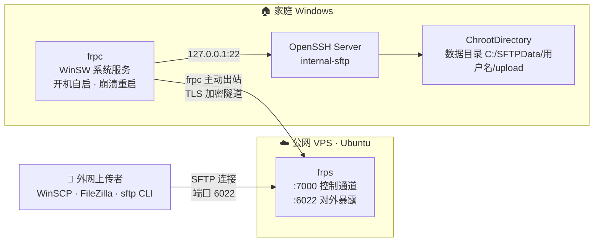

<div align="center">

# 🏠 home-sftp-frp

**家庭 SFTP 公网直传方案**

让外网用户安全地把文件传到你家里的 Windows 电脑 —— 无需公网 IP、无需路由器端口映射、无需暴露家庭网络

[](#-架构)
[](https://github.com/fatedier/frp)
[](#-项目结构)
[](#-项目结构)
[](LICENSE)
[](https://github.com/zhaoqian-dong/home-sftp-frp/stargazers)

[✨ 功能特性](#-功能特性) · [🏗 架构](#-架构) · [🚀 快速开始](#-快速开始) · [📤 给上传者的一页](#-给上传者的一页) · [🔐 安全设计](#-安全设计) · [❓ 排障](#-常见排障)

</div>

---

## 📖 这是什么

在外地的同事、朋友或自动化设备需要往你家里传文件？

本项目提供**一套开箱即用的自动化脚本**，把家里的 Windows 电脑变成一台 SFTP 服务器，
并通过一台便宜的公网 VPS 反向代理到互联网。每个上传者拥有独立账号，
登录即进入自己的 `/upload` 目录并被 chroot 隔离——互相看不到对方的文件，也看不到你系统里的任何内容。

> 组合了 GitHub 上久经考验的成熟组件：
> [frp](https://github.com/fatedier/frp)（90k+ ⭐ 反向代理）· Windows 内置 OpenSSH Server ·
> [WinSW](https://github.com/winsw/winsw)（Windows 服务包装）· [WinSCP](https://winscp.net)（图形客户端）

## ✨ 功能特性

- 🔒 **chroot 严格隔离** —— 每账号一个 `ChrootDirectory` + NTFS ACL 断继承，账号间互不可见
- 🙈 **家庭网络零暴露** —— frpc 只发起出站连接，家里不开任何入站端口，上传者只见 VPS IP
- 🔐 **多层加密认证** —— frp 强制 TLS + 随机 token；SFTP 走标准 SSH 加密
- 🩹 **断线自愈** —— frp 心跳自动重连 + Windows 服务崩溃自动重启 + 开机自启，断电恢复即恢复服务
- ⚡ **双端一键部署** —— VPS 端一条 Bash、家庭端一条 PowerShell，全部幂等可重跑
- 🛡 **纵深防御** —— fail2ban 防爆破、ufw 防火墙、管理面板仅回环、上传账号禁 shell/转发/TTY
- 🇨🇳 **国内网络友好** —— GitHub 下载失败自动回退国内加速镜像，腾讯云轻量服务器全程适配
- 📦 **双形态客户端** —— WinSCP 图形界面 + 命令行上传脚本，给非技术用户也能用

## 🏗 架构



**数据流：**

1. 上传者用任意 SFTP 客户端连接 `VPS_IP:6022`（只见 VPS，不见家庭 IP）；
2. frps 通过 **TLS 加密隧道**把流量转给主动连上来的家里 frpc；
3. frpc 转发给本机 sshd 的 `internal-sftp`（公网访问家庭 22 端口的防火墙规则已收紧为仅局域网）；
4. sshd 按 `Match User` 将每个账号 chroot 到 `C:\SFTPData\<用户名>`，直接落在 `upload/` 里。

## 📦 项目结构

```
home-sftp-frp/
├── README.md                        ← 本文件
├── LICENSE
├── .env.example                     ← 唯一配置源（复制为 .env 使用）
├── docs/
│   └── vps-rental-guide.md          ← 租服务器指南（含机型推荐与优惠链接）
├── config/                          ← 仅供参考展示；实际配置由脚本内嵌模板生成
│   ├── frps.toml.template
│   └── frpc.toml.template
└── scripts/
    ├── setup-vps.sh                 ← ① VPS 端一键脚本（Ubuntu，root 运行）
    └── windows/
        ├── setup-home-windows.ps1   ← ② 家庭 Windows 一键脚本（管理员）
        ├── add-sftp-user.ps1        ← ③ 创建/重置上传账号（可反复执行）
        ├── setup-client.ps1         ← ④ 你的 Windows 客户端配置（装 WinSCP + 桌面工具）
        └── upload.ps1               ← 命令行上传（免 GUI）
```

## 🚀 快速开始

### 第 0 步 · 准备配置

```bash
cp .env.example .env
```

先只填 `VPS_IP=`（租完服务器就有），其余项在对应步骤补齐。
**同一份 `.env` 之后会同时放到 VPS 和家庭 Windows 上，是唯一的配置来源。**

### 第 1 步 · 租一台 VPS

照着 [docs/vps-rental-guide.md](docs/vps-rental-guide.md) 操作，推荐：

| 机型 | 配置 | 价格 | 适合 |
|---|---|---|---|
| 腾讯云轻量应用服务器 | 2核2G | 99 元/年 | 只跑 frp 反代，本项目够用 |
| 腾讯云轻量应用服务器 | 2核4G | 199 元/年 | 除 frp 外还想跑其他服务 |

👉 [新用户特惠入口](https://cloud.tencent.com/act/cps/redirect?redirect=2446&cps_key=d579dcb5b5e80978383f637d05d3f71b&from=console)（选 Ubuntu 24.04 LTS 镜像，地域国内即可——纯 IP+TCP 用途无需备案）

⚠️ **最容易漏的一步**：轻量服务器控制台 → 防火墙 → 放行 TCP `22 / 7000 / 6022`
（云端防火墙与系统 ufw 是两道独立关卡，脚本只能配置后者）。

### 第 2 步 · VPS 一键部署

```bash
scp scripts/setup-vps.sh .env root@<VPS_IP>:/root/
ssh root@<VPS_IP>
bash setup-vps.sh
```

自动完成：安装 frps → systemd 服务 → fail2ban 防爆破 → ufw 防火墙。
若 `.env` 里 `FRP_TOKEN` 留空，脚本会**自动生成并打印**——回填到本地 `.env` 即可。

### 第 3 步 · 家庭 Windows 一键部署

把 `scripts/windows/` 整个目录 + `.env` 放到同一文件夹，管理员 PowerShell 执行：

```powershell
powershell -ExecutionPolicy Bypass -File .\setup-home-windows.ps1
```

自动完成：安装内置 OpenSSH Server（SFTP 端）→ 防火墙收紧为仅局域网 →
建 `C:\SFTPData` → 安装 frpc 并生成配置 → 用 WinSW 注册为 Windows 服务。

### 第 4 步 · 创建上传账号（每人一个，可反复执行）

```powershell
powershell -ExecutionPolicy Bypass -File .\add-sftp-user.ps1 -UserName zhangsan
```

脚本打印该账号的地址 / 用户名 / 密码，发给对方（建议走私聊）。
账号再跑一次同样命令即重置密码。账号能力边界：**只能 SFTP、只能进自己的 `/upload`、
被 chroot 锁定、不能转发端口、不能登录 shell**。

### 第 5 步 · 客户端配置与测试

在你平时用的 Windows 上（管理员）：

```powershell
powershell -ExecutionPolicy Bypass -File .\setup-client.ps1
```

桌面生成 `Home-SFTP` 文件夹：双击 **连接SFTP.cmd** 打开 WinSCP 图形界面，
或命令行 `.\upload.ps1 -Path C:\data\xxx.zip` 上传。
首次连接会提示接受主机指纹，输入 y / 点"是"，仅一次。

<details>
<summary><b>✅ 部署完成自检清单（点开逐项走一遍）</b></summary>

```bash
# VPS 上：frps 在监听
ss -tlnp | grep -E ':(7000|6022)'
systemctl status frps --no-pager
```

```powershell
# 家庭 Windows 上：frpc 已连接（日志应有 login to server success）
Get-Content 'C:\Program Files\frp\frpc.log' -Tail 20
Get-Service frpc, sshd
```

最后：任选一种客户端用上传账号连 `sftp://<VPS_IP>:6022`，拖一个文件进去，
到家庭 `C:\SFTPData\<用户名>\upload\` 确认文件出现 —— 全链路即通。

</details>

## 📤 给上传者的一页

> 复制下面这段发给对方即可，对方不需要安装本项目任何脚本。

> **往我家传文件的方法**
>
> | 项 | 值 |
> |---|---|
> | 地址 | `<VPS_IP>` |
> | 端口 | `6022` |
> | 协议 | SFTP（不是 FTP） |
> | 用户/密码 | （另行私发） |
>
> - **WinSCP**（推荐）：[winscp.net](https://winscp.net) 下载 → 新建会话填上面四项 →
>   文件协议选 SFTP → 登录（首次提示"未知主机密钥"点"是"）→ 拖拽上传
> - **FileZilla**：站点管理器 → 协议选 SFTP → 填上面四项
> - **命令行**（Win10/11 自带）：`sftp -P 6022 用户名@<VPS_IP>`，`put 文件名` 上传
>
> 登录后你只能看到自己的 `/upload` 目录。大文件速度取决于你的上传带宽与线路。

## 🔐 安全设计

| 层 | 措施 |
|---|---|
| 传输 | frpc↔frps 强制 TLS；对外是标准 SSH/SFTP 加密 |
| 认证 | frp token（32 位随机）；SFTP 每账号独立密码；VPS SSH 建议 key 登录 |
| 隔离 | 每账号 `ChrootDirectory` 锁定自己目录 + NTFS ACL 断继承，账号间互不可见 |
| 权限 | 上传账号是非管理员本地用户，禁 shell/端口转发/TTY，密码永不过期但不可自改 |
| 暴露面 | 家庭 22 端口仅限局域网；VPS 仅开放 22/7000/6022；frp 管理面板仅回环 |
| 爆破防护 | fail2ban（VPS sshd 5 次失败封 1 小时）；上传账号走 chroot 无法触碰其他服务 |

**已知限制（如实说明）：**

- Windows OpenSSH 的 `ChrootDirectory` 不做 Linux 式属主强校验，隔离实际由 NTFS ACL 保证
  （脚本已按最佳实践配置；要求 Win10 1809+ 内置 OpenSSH ≥ 7.7）；
- `setup-client.ps1` 生成的桌面工具内含明文密码（个人机便利性取舍），请勿转发，
  给上传者只发上面的说明文本；
- 所有流量过 VPS，速度上限 ≈ VPS 带宽（轻量套餐常见 3~6 Mbps，详见[租赁指南](docs/vps-rental-guide.md)）。

## ❓ 常见排障

| 现象 | 原因与处理 |
|---|---|
| 上传者连接超时 | 九成是**腾讯云控制台防火墙没放行 6022/7000**；其次检查 `.env` 端口与脚本输出一致 |
| frpc 日志报 auth failed | 两端 `FRP_TOKEN` 不一致：确认 `.env` 已回填并重跑两端脚本（或手动同步 frps.toml/frpc.toml 后重启服务） |
| frpc 日志报 connect server timeout | VPS 侧 7000 未放行，或 VPS 宕机/过期 |
| frpc 连上但 SFTP 登录失败 | 家庭 sshd 没起来：`Get-Service sshd`；或账号密码错：重跑 `add-sftp-user.ps1` 重置 |
| 能登录但看不到 upload | `C:\SFTPData\<用户名>\upload` 被手动改动：重跑 `add-sftp-user.ps1` 修复 |
| 传输速度只有几百 KB/s | 正常：受 VPS 带宽限制（见[租赁指南](docs/vps-rental-guide.md)第五节），可升级带宽 |
| 家庭重启后没恢复 | frpc 与 sshd 均为开机自启；若仍不通看 `Get-Service frpc` 与日志，必要时 `Restart-Service frpc` |

## 🧰 日常维护

<details>
<summary><b>家庭 Windows（PowerShell）</b></summary>

```powershell
Restart-Service frpc                                  # 重启隧道
Get-Content 'C:\Program Files\frp\frpc.log' -Tail 50  # 看日志
.\add-sftp-user.ps1 -UserName lisi                    # 加账号
.\add-sftp-user.ps1 -UserName zhangsan -Password 'New12345'   # 重置密码
```

</details>

<details>
<summary><b>VPS（Ubuntu）</b></summary>

```bash
journalctl -u frps -n 50          # frps 日志
systemctl restart frps
vim /etc/frp/frps.toml            # 改完记得 systemctl restart frps
fail2ban-client status sshd       # 查看封禁列表
```

</details>

<details>
<summary><b>升级 / 换配置 / 卸载</b></summary>

- **升级 frp**：改脚本顶部 `FRP_VERSION`，两端重跑即可（旧配置自动备份保留）；
- **换 token**：改 `.env` 的 `FRP_TOKEN` → VPS 重跑 `setup-vps.sh` → 家庭重跑 `setup-home-windows.ps1`；
- **换 SFTP 公网端口**：改 `.env` 的 `SFTP_PUBLIC_PORT` → 家庭重跑步骤 3 脚本 → VPS 控制台防火墙放行新端口；
- **卸载 VPS**：`systemctl disable --now frps && rm -rf /etc/frp /usr/local/bin/frps /etc/systemd/system/frps.service`
- **卸载家庭 Windows**：`C:\Program Files\frp\frpc-service.exe uninstall`，再按需停用 OpenSSH Server 功能。

</details>

## 🙏 致谢

本项目站在这些优秀开源项目的肩膀上：

| 项目 | 作用 |
|---|---|
| [fatedier/frp](https://github.com/fatedier/frp) | 高性能反向代理，内网穿透核心 |
| [PowerShell/Win32-OpenSSH](https://github.com/PowerShell/Win32-OpenSSH) | Windows 内置 OpenSSH，提供 SFTP 服务端 |
| [winsw/winsw](https://github.com/winsw/winsw) | 把 frpc 包装为可靠的 Windows 服务 |
| [winscp/winscp](https://github.com/winscp/winscp) | Windows 下最好用的 SFTP 图形客户端 |

## 📄 许可证

[MIT](LICENSE) © 2026
